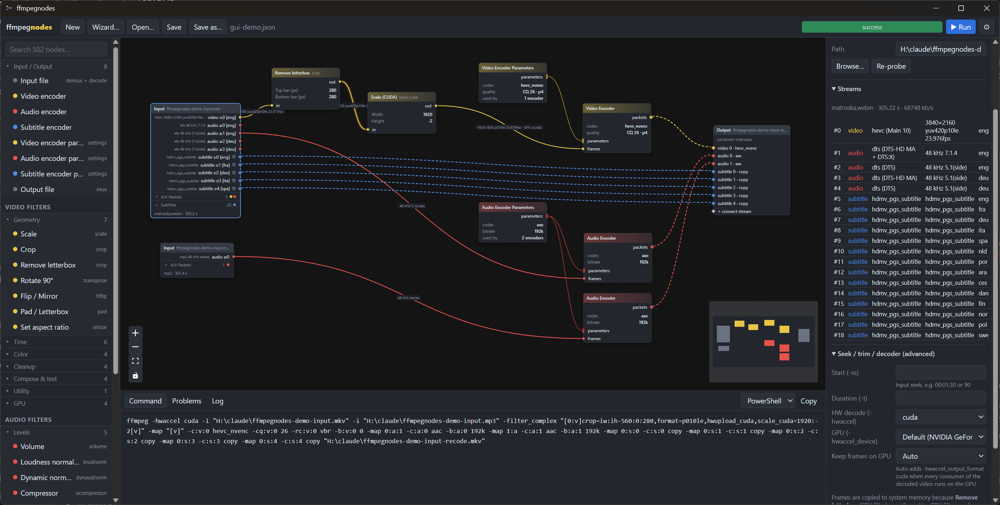
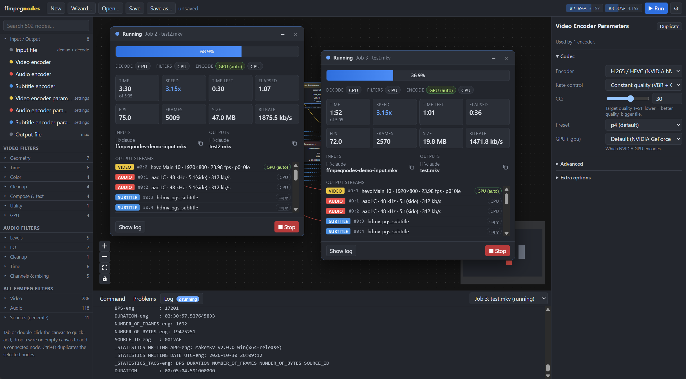

# ffmpegnodes

**A desktop node editor for ffmpeg!**

You wire up inputs, filters, encoders and outputs, and the app turns the graph into a single ffmpeg command. It checks that command before it runs and then runs it with live progress.

- Supports multiple inputs & outputs
- Supports CUDA decode + filters + encode
- Includes over 500 filter nodes + parameters
- Wizard for quick video-recoding node trees
- Start multiple parallel jobs
- Save/Load node trees

|  |
|:---:|
| *Main Screen & Node Tree* |

|  |
|:---:|
| *Multiple Parallel Jobs* |

Built with Tauri 2 (Rust) and React.

## Concepts

| Pad | Shape | Meaning |
|---|---|---|
| **frames** | round | Decoded media. Filters take frames in and put frames out; encoders take them in. |
| **packets** | diamond, plus a ⬡ icon on the Input | Encoded media. Encoders put packets out and the Output takes them in. Wiring an Input's packet pad straight to the Output is a stream copy (`-c copy`). |
| **parameters** | small upright rectangle | Encoder settings, sent from an Encoder Parameters node into the top pad of one or more encoders. |

- **Colours:** video is yellow, audio is red and subtitles are blue. Parameter pads and wires use a darker shade of their media colour.
- **Connections:** a connection is only allowed when the domain and the media type match.

## Features

- **Nodes**
  - **Input file:** probed with ffprobe. It has one frames pad and one packets pad per stream, labelled with codec, size or channels, and language.
  - **Filters:**
    - A curated set with friendly settings: scale, crop, deinterlace, denoise, loudness, downmix, and more.
    - Every other filter in your ffmpeg build, under "All ffmpeg filters". Their options are read from `ffmpeg -h filter=…`.
    - **Help:** the **?** next to a filter or option opens the matching part of the official ffmpeg filter docs: what it does, accepted values, expression variables and examples. For "All ffmpeg filters" it also shows the type, default and range your ffmpeg reports. The docs are bundled, so this works offline.
  - **Help on Input and Encoder Parameters:** the **?** next to an encoder or setting shows the ffmpeg docs for it: the encoder's own options (e.g. libx264 `crf`, nvenc `cq`), generic codec options (`b`, `maxrate`, `threads`) and ffmpeg options (`-ss`, `-hwaccel`, `-r`).
  - **Remove letterbox:** detects black bars at the top and bottom of the video and crops them away.
  - **Video / Audio / Subtitle Encoder Parameters:** codec and all its options in one node. One node can feed any number of encoders, e.g. five audio tracks with the same AAC settings. Each new encoder gets its own connected parameters node.
  - **Encoders:** take their settings from a parameters node. Without one they show an error, and their stream is left out of the command.
  - **Output file:** container, stream order, per-stream language, title and disposition.
- **Codecs:** libx264/libx265, SVT-AV1 (AV1 on the CPU), VP9 (libvpx) and ProRes (prores_ks); NVIDIA NVENC (H.264, HEVC, AV1) with GPU selection; AAC, libfdk_aac, Opus, MP3, AC-3, E-AC-3, FLAC, ALAC and PCM (16/24-bit, 32-bit float); mov_text, srt, ass and WebVTT; plus stream copy.
- **GPU pipeline:** CUDA decoding, Scale (CUDA), then nvenc. Frames stay on the GPU whenever every step can use them.
- **Checks before running:**
  - Formats such as size, pixel format and sample rate are worked out along each wire.
  - Problems appear in the *Problems* tab.
  - One-click fixes, e.g. "Use yuv420p10le" or "Decode with cuda". Fixes for encoder settings change the parameters node.
- **Recode wizard** (*Wizard…* in the toolbar):
  1. Pick a file.
  2. Choose video streams, filters, codec and GPU.
  3. Choose audio streams, filters and codec.
  4. Choose subtitles and the output file.

  The wizard then builds the complete, wired graph in tidy columns: Input → filters → parameters → encoders → Output.
- **Editing:**
  - **Quick-add:** press Tab or double-click the canvas, or drop a wire on empty space to add a node that is already connected.
  - **Duplicate:** Ctrl+D copies the selected nodes with their settings. Ctrl+Shift+D also copies their incoming wires.
  - **Projects:** save and open as `.ffmpegnodes.json`, with autosave.
- **Run:** a live command preview, copyable for PowerShell or other shells; progress, speed and cancel.

## Prerequisites

- Node 20+ and pnpm.
- Rust (https://rustup.rs). On Windows you also need the MSVC build tools and WebView2; see https://tauri.app/start/prerequisites/.
- `ffmpeg` and `ffprobe`: Set their paths in the app's ⚙ Settings. NVENC and CUDA features need an NVIDIA GPU and an ffmpeg build that includes them. Tip: Use static builds!

## Run

Install the dependencies:

```bash
pnpm install
```

Start the desktop app:

```bash
pnpm tauri dev
```

UI only, in a browser. Here ffprobe, ffmpeg and letterbox detection are mocked:

```bash
pnpm dev
```

## Test

```bash
pnpm typecheck
```

```bash
pnpm test
```

End-to-end runs against a real ffmpeg are opt-in. They need `ffmpeg` / `ffprobe` with libx265 on PATH, and the second variable adds the NVENC/CUDA runs:

```bash
FFMPEG_E2E=1 FFMPEG_E2E_NVENC=1 pnpm test
```

The Rust side (process handling and letterbox detection):

```bash
cd src-tauri && cargo test
```

## Layout

| Path | What |
|---|---|
| `src/serializer/` | graph → ffmpeg argv: filtergraph building, split insertion, chain joining, escaping, shell quoting |
| `src/validation/` | connection rules, format negotiation along wires, codec/container compatibility, diagnostics and quick fixes |
| `src/model/` | shared types; encoder-parameter resolution, GPU residency, letterbox helpers |
| `src/nodes/defs/` | pads per node, curated filter definitions, encoder schemas, generic filters from `ffmpeg -h` |
| `src/docs/` | ffmpeg docs for the help popups: parser for FFmpeg's texinfo docs, the bundled `filterDocs.json` and `optionDocs.json`, and lookups |
| `scripts/` | `gen-docs.ts` (regenerates the bundled docs), `release-prep.mjs`, `check-filter-docs.mjs` |
| `src/nodes/ui/`, `src/inspector/`, `src/ui/` | React Flow nodes, Inspector panel, canvas, palette, quick-add, dock, toolbar |
| `src/wizard/` | recode wizard: dialog and graph builder with column layout |
| `src/store/` | zustand store, duplicate, project files, autosave |
| `src/ipc/` | typed Tauri bridge and the browser mock |
| `src-tauri/src/ffmpeg.rs` | runs ffprobe/ffmpeg (argument lists only, never a shell), streams `-progress`, cancel, GPU list, filter help |
| `src-tauri/src/letterbox.rs` | black-bar detection on sampled frames |

## Trademark

Not affiliated with or endorsed by the FFmpeg project. FFmpeg is a trademark of Fabrice Bellard.
